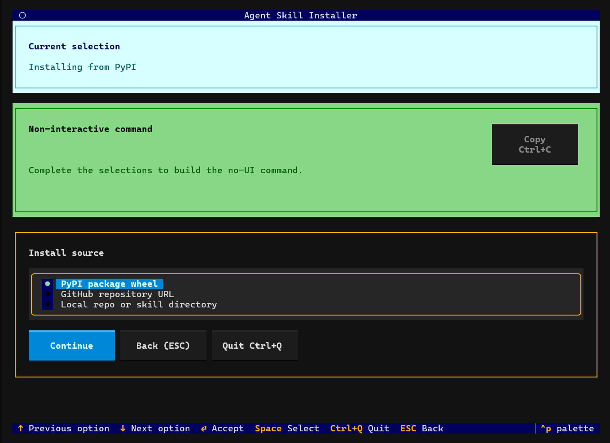

# Agent Skill Installer

|  | Description |
| --- | --- |
| Project | [](https://badge.fury.io/py/agent-skill-installer)[](https://pepy.tech/project/agent-skill-installer) [](https://pypi.org/project/agent-skill-installer/) [](https://github.com/omry/agent-skill-installer/blob/main/LICENSE) |
| Status | [](https://github.com/omry/agent-skill-installer/actions/workflows/ci.yml) [](https://github.com/omry/agent-skill-installer/actions/workflows/publish.yml) |
| Docs and support | [](https://hydra-framework.zulipchat.com/#narrow/channel/agent-skill-installer) |

`agent-skill-installer` installs agent skills for Codex, Claude Code, Gemini CLI,
and Antigravity from local skill directories, GitHub repositories, or PyPI
wheels. It supports directory and global targets, can assert directory targets
are Git or Sapling repositories with `--repo`, writes discoverability blocks into
the target's instruction files, and records enough install state to safely
upgrade or uninstall skills it owns.

ASI installs raw agent skills: directories containing `SKILL.md`. A Codex
plugin is a separate distribution format identified by
`.codex-plugin/plugin.json`; it can also bundle MCP servers, apps, hooks, and
other plugin metadata. ASI does not install Codex plugins as plugins. Use
[Codex's plugin workflow](https://developers.openai.com/codex/plugins/build)
when those plugin-level features are required.

### Agent targets

Gemini CLI and Antigravity integrations are **experimental**. Antigravity has
had limited manual testing; Gemini CLI has not yet had manual testing. Verify
the installed skills, discoverability, and hooks in the agent before relying
on them.

Use one target, a comma-separated list, or `--agent all`:

| Target | Directory discovery | Global discovery | Runtime hooks |
| --- | --- | --- | --- |
| `codex` | `.codex/skills` and `AGENTS.md` | `~/.codex/skills` and `~/.codex/AGENTS.md` | `.codex/hooks.json` |
| `claude` | `.claude/skills` and `CLAUDE.md` | `~/.claude/skills` and `~/.claude/CLAUDE.md` | Not installed |
| `gemini` (experimental) | `.gemini/skills` and `GEMINI.md` | `~/.gemini/skills` and `~/.gemini/GEMINI.md` | `.gemini/settings.json` |
| `antigravity` (experimental) | `.agents/skills` and `.agents/rules/*.md` | `~/.gemini/config/skills` and `~/.gemini/config/rules/*.md` | `.agents/hooks.json` |

The complete path matrix, target-home overrides, hook behavior, and uninstall
ownership rules are in [Installing Skills](docs/installing-skills.md). Skill
metadata and per-agent hook schemas are in [Authoring Skills](docs/authoring-skills.md).

## Install

```bash
python -m pip install agent-skill-installer
```

Run the interactive installer:

```bash
agent-skill-installer
```



Use `--no-ui` for scripts:

```bash
agent-skill-installer --no-ui install \
  --skill-path ./my-skill \
  --editable \
  --agent codex \
  --scope dir \
  --repo
```

## Documentation

| Audience | Start here |
| --- | --- |
| Installing a skill | [Installing Skills](https://github.com/omry/agent-skill-installer/blob/main/docs/installing-skills.md) |
| Writing a skill directory or GitHub skill repo | [Authoring Skills](https://github.com/omry/agent-skill-installer/blob/main/docs/authoring-skills.md) |
| Publishing a skill on PyPI or with platform wheels | [Packaging](https://github.com/omry/agent-skill-installer/blob/main/docs/packaging.md) |
| Embedding the installer API or exposing a wrapper CLI | [API And Wrapper CLI](https://github.com/omry/agent-skill-installer/blob/main/docs/api-and-wrapper-cli.md) |
| Maintaining releases | [Maintainer Guide](https://github.com/omry/agent-skill-installer/blob/main/docs/maintainer-guide.md) |

## Examples

The [`examples/`](https://github.com/omry/agent-skill-installer/blob/main/examples/README.md) directory contains runnable integrations:

- `examples/demo-installer/` is a complete Python package that carries a bundled
  skill and exposes a project-specific wrapper command.
- `examples/wheel-skill/` is a plain wheel-packaged skill for generic
  `--wheel-file` installs.
- `examples/api-install/` shows direct Python API usage without a wrapper
  console script.
